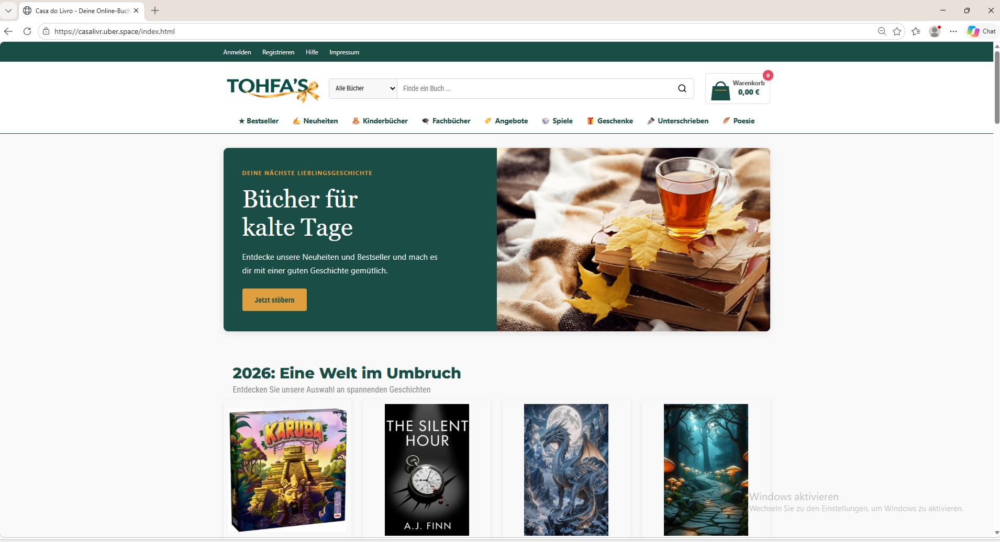
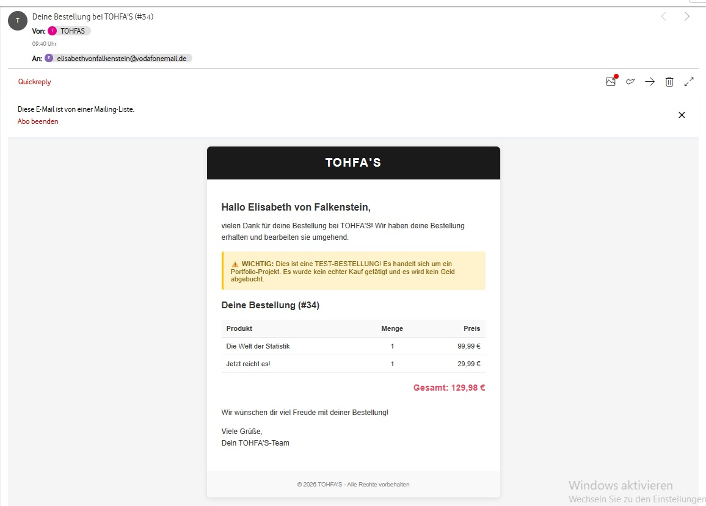
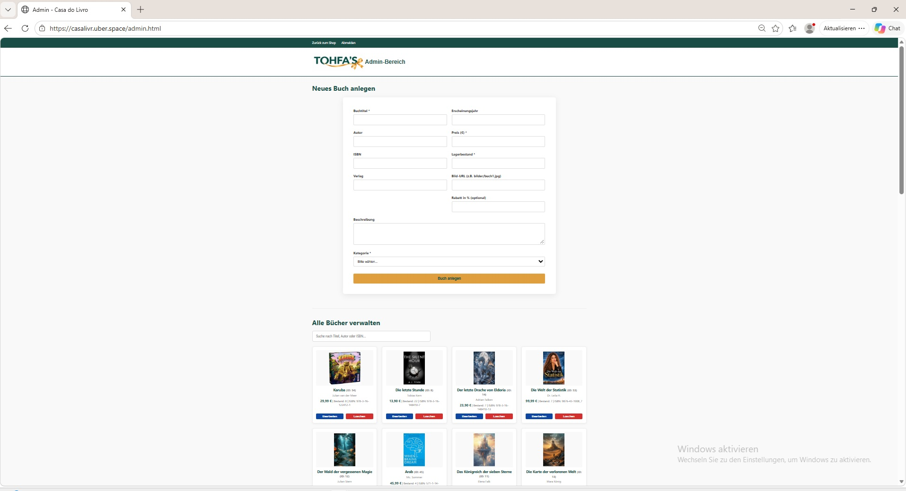
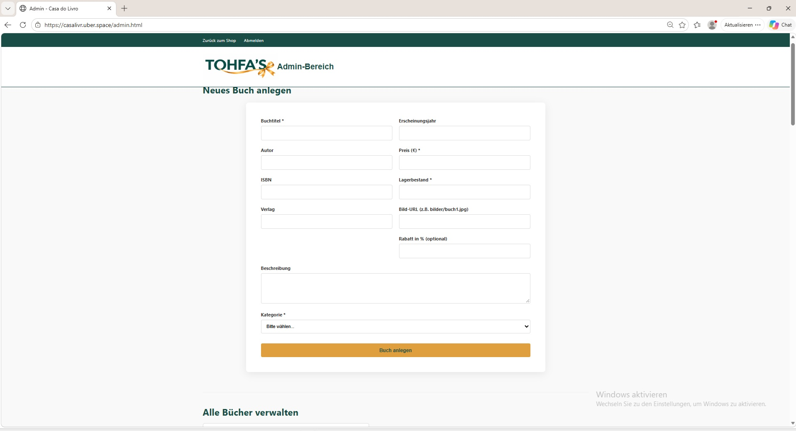
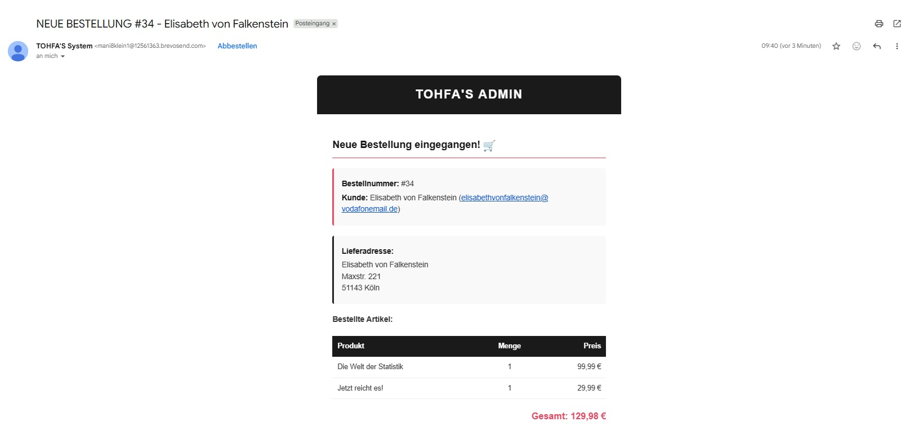
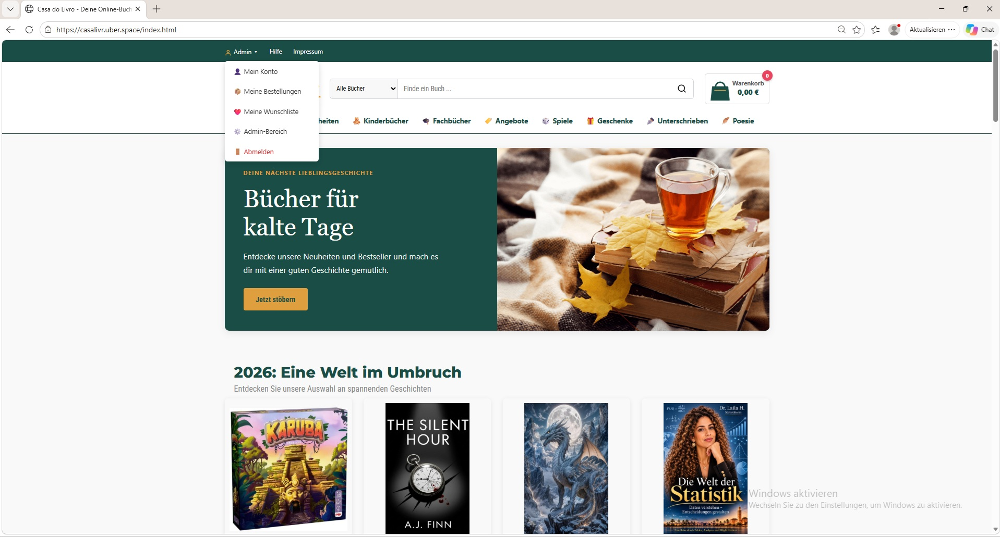
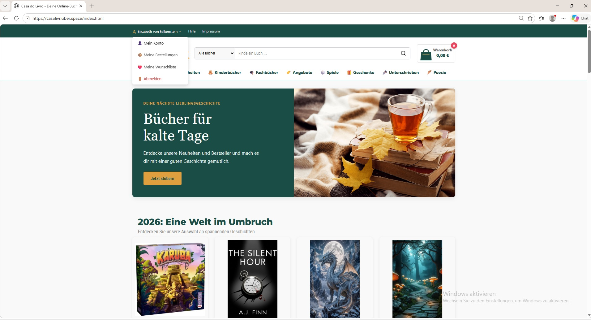

# 📚 TOHFA'S – Online-Buchhandlung

Ein vollständiger, full-stack Online-Buchladen, der von der Datenbank bis zum Frontend komplett selbst entwickelt wurde. Dieses Projekt dient als Portfolio-Projekt, um moderne Backend- und Frontend-Entwicklung zu demonstrieren.

## 🚀 Live-Demo

Die Anwendung ist live auf Uberspace gehostet:
*   **Frontend:** [https://casalivr.uber.space/](https://casalivr.uber.space/)
*   **Backend (API):** [https://casalivr.uber.space/produkte](https://casalivr.uber.space/produkte)

*Hinweis: Die Anwendung läuft auf einem deutschen Server (Uberspace) und ist dauerhaft über systemd verfügbar.*

## ✨ Features

*   **Produktverwaltung:** Anzeige von Büchern mit Covern, Autoren, ISBN, Verlag und Erscheinungsjahr.
*   **Kategorien:** Filterung von Büchern nach Kategorien (Romane, Krimis, Fantasy, etc.).
*   **Benutzerverwaltung:** Sichere Registrierung und Login mit JWT (JSON Web Tokens).
*   **Rollen-System:** Unterscheidung zwischen normalen Kunden und Administratoren.
*   **Admin-Bereich:** Erstellen, Bearbeiten und Löschen von Büchern (nur für Admins).
*   **Rabatt-System:** Dynamische Berechnung von Rabatten (Prozentual) für Sonderangebote.
*   **Warenkorb:** Hinzufügen, Ändern der Menge und Entfernen von Büchern.
*   **Wunschliste:** Speichern von Lieblingsbüchern für später.
*   **Checkout:** Eingabe der Lieferadresse mit Validierung (z.B. 5-stellige PLZ).
*   **Bestellungen:** Bestellübersicht für Kunden und Reduzierung des Lagerbestands nach dem Kauf.
*   **E-Mail-Benachrichtigungen:** Automatischer Versand von Bestellbestätigungen an den Kunden und Benachrichtigungen an den Admin über die Brevo API.
*   **Responsive Design:** Optimierte Darstellung für Desktop und Mobilgeräte (inkl. Hamburger-Menü).
*   **Suche:** Globale Suche nach Titel, Autor oder ISBN.

## 🛠️ Tech-Stack

### Backend
*   **Python / FastAPI:** Modernes, schnelles Web-Framework.
*   **SQLAlchemy:** ORM für die Datenbank-Interaktion.
*   **PostgreSQL:** Relationale Datenbank (Live-Produktion).
*   **SQLite:** Lokaler Fallback für einfaches Testen ohne Installation.
*   **JWT (python-jose):** Sichere Authentifizierung.
*   **bcrypt:** Passwort-Hashing.
*   **Pydantic:** Datenvalidierung.
*   **Brevo API:** Transaktions-E-Mails.

### Frontend
*   **HTML5 / CSS3:** Struktur und responsives Styling.
*   **Vanilla JavaScript:** Interaktive Logik und Fetch-API für die Kommunikation mit dem Backend.
*   **Kein Framework:** Zeigt ein tiefes Verständnis der Web-Grundlagen.

### DevOps & Testing
*   **Systemd:** Dauerhafter Betrieb des Backends auf dem Server.
*   **Docker (Optional):** Dockerfile und docker-compose.yml für die lokale Entwicklung vorhanden.
*   **GitHub Actions:** CI/CD-Pipeline, die bei jedem Push automatisch Tests ausführt.
*   **Pytest:** Automatisierte Tests für die Backend-Routen mit über 90 % Code-Coverage.

## 💻 Lokale Installation

So startest du das Projekt auf deinem eigenen Rechner:

**1. Repository klonen:**
```bash
git clone https://github.com/mani8klein1-jpg/buecher-shop.git
cd buecher-shop

**2. Virtuelle Umgebung erstellen und aktivieren:**
python -m venv venv
# Windows (PowerShell):
.\venv\Scripts\Activate.ps1
# Windows (CMD):
venv\Scripts\activate
# Linux/Mac:
source venv/bin/activate

**3. Abhängigkeiten installieren:**
pip install -r requirements.txt

**4. Umgebungsvariablen einrichten:**
Kopiere die .env.example Datei und benenne sie in .env um. Für die lokale Entwicklung ist keine PostgreSQL-Datenbank nötig – es wird automatisch eine SQLite-Datenbank verwendet.

cp .env.example .env

Hinweis: Für den lokalen Test wird kein Brevo-API-Key benötigt. E-Mails werden dann nur in der Konsole simuliert.

**5. Datenbank mit Testdaten füllen (Optional, aber empfohlen):**
python seed.py

**6. Backend starten:**
python -m uvicorn main:app --reload

(Hinweis für Windows 11: Falls uvicorn.exe von der Smart App Control blockiert wird, bitte python -m uvicorn main:app --reload verwenden).

**7. Frontend starten (in einem neuen Terminal):**
cd frontend
python -m http.server 8080

Die Anwendung ist dann unter http://127.0.0.1:8080 erreichbar. 
Die API-Dokumentation findest du unter http://127.0.0.1:8000/docs.

## 📸 Screenshots

### Startseite


### Kunden-Bestellbestätigung


### Admin-Bereich


### Admin-Bereich (Detailansicht)


### Admin-Benachrichtigung (E-Mail)


### Eingeloggter Admin


### Eingeloggter Kunde



---
Entwickelt von Rachid Tohfa – Als Portfolio-Projekt für die Bewerbung als Backend-Entwickler.